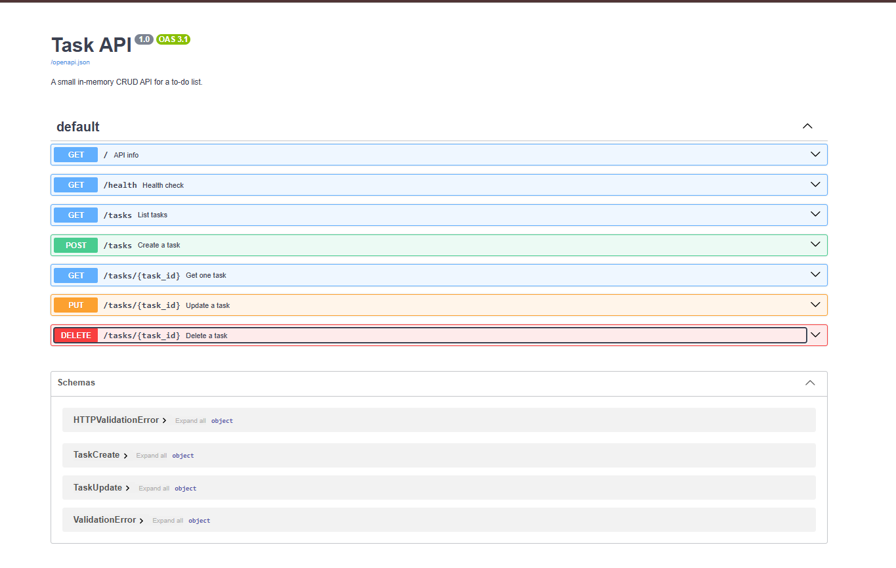
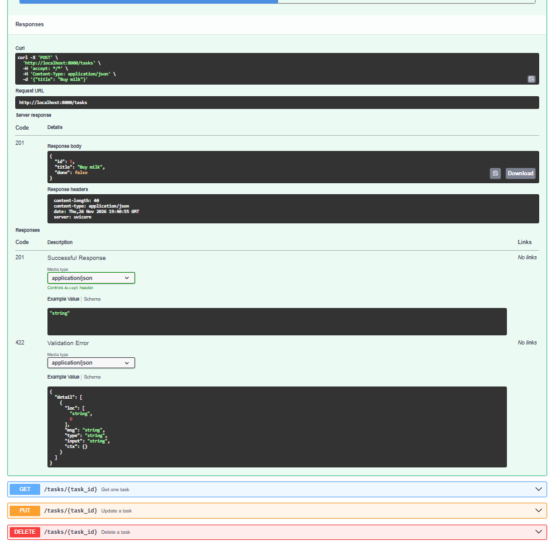

# Task API

A small in-memory CRUD API for a to-do list, built with **FastAPI** (Python).
You can create, read, update and delete tasks. There is no database, so data lives
in memory and is lost when the server restarts.

## Install & run

Requires Python 3.10+.

```bash
pip install -r requirements.txt
uvicorn main:app --reload
```

The API runs at <http://localhost:8000>.
Swagger UI (interactive docs) is at <http://localhost:8000/docs>.

## Endpoints

| Method | Path | Description | Success | Errors |
| ------ | ---- | ----------- | ------- | ------ |
| GET | `/` | API info | 200 | |
| GET | `/health` | Health check | 200 | |
| GET | `/tasks` | List all tasks | 200 | |
| GET | `/tasks/{id}` | Get one task | 200 | 404 |
| POST | `/tasks` | Create a task, body `{"title": "..."}` | 201 | 400 |
| PUT | `/tasks/{id}` | Update `title` and/or `done` | 200 | 400, 404 |
| DELETE | `/tasks/{id}` | Delete a task | 204 | 404 |

All errors return JSON like `{ "error": "Task 99 not found" }`.

## Example `curl -i` output

```
curl -i http://localhost:8000/tasks/1
HTTP/1.1 200 OK
date: Thu, 26 Nov 2026 20:32:09 GMT
server: uvicorn
content-length: 45
content-type: application/json

{"id":1,"title":"Buy groceries","done":false}```

## Swagger UI

All endpoints listed at `/docs`:



"Try it out" creating a task (201 Created):



## The mortality experiment

WRITE 2 SENTENCES HERE about what happened to your tasks after restarting the server, and why.